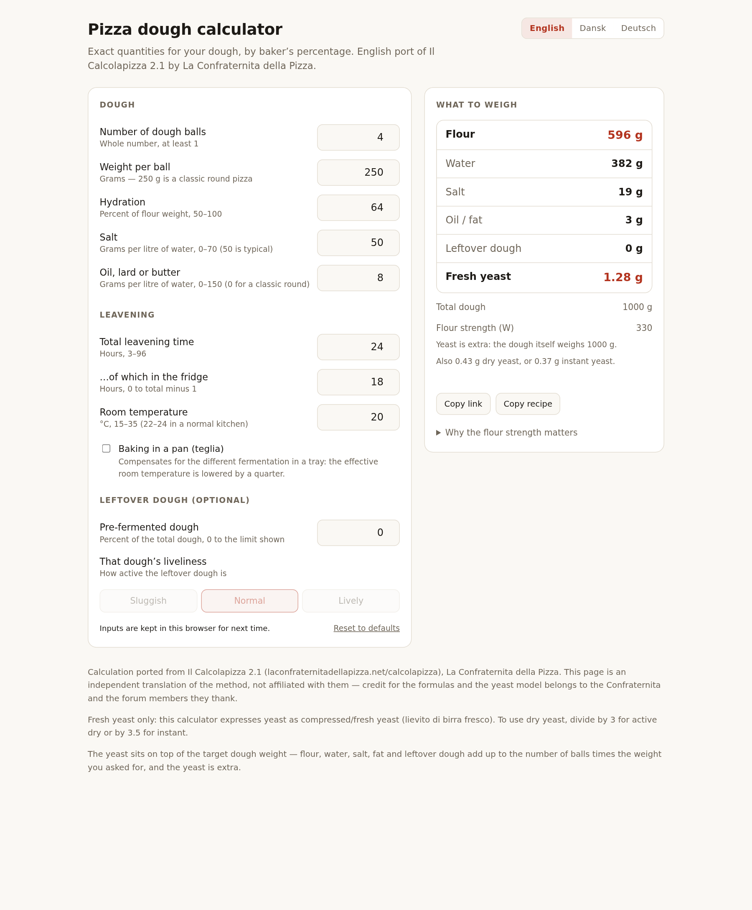

# Pizza dough calculator · Pizzadejsberegner · Pizzateig-Rechner

Exact dough quantities by baker's percentage, in a single self-contained HTML file. No build step, no
dependencies, no tracking — open `index.html` and it works, offline included.

This is an independent port of [Il Calcolapizza 2.1](https://laconfraternitadellapizza.net/calcolapizza/)
by La Confraternita della Pizza — the formulas, the yeast model and the vocabulary are theirs, the
implementation is not. It is not affiliated with or endorsed by them. The Italian original is the reference;
if the two disagree, it is right and this is wrong.

## What it does

- **Baker's percentage in both directions.** Give it the number of balls, the ball weight and the
  hydration; it returns flour, water, salt, fat and fresh yeast, plus the total dough and the flour
  strength (W) that fits the hydration.
- **Fermentation is part of the maths.** Total leavening time, how much of it sits in the fridge, room
  temperature, and the teglia correction all feed the yeast quantity, so a 24 h room-temperature dough and
  a 24 h cold-fermented one do not get the same amount of yeast.
- **Leftover dough.** If you keep a piece of pre-fermented dough from the last batch, enter its percentage
  and how lively it still is; the yeast quantity drops accordingly.
- **Yeast equivalents.** Fresh yeast is the figure; active dry and instant equivalents are shown next to it.
- **Three languages** — English, Danish and German — with per-language decimal separators.
- **Shareable links.** The whole recipe lives in the URL (`?n=4&w=250&h=64&…`), so a link reproduces exactly
  the dough you meant, including the language. *Copy link* and *Copy recipe* produce text you can paste into
  a message; if the browser blocks clipboard access, a dialog shows the text to copy by hand.
- **One-page print.** *Print* gives a single A4 kitchen sheet with the inputs, the weights and the schedule —
  the buttons, language switcher and hints are excluded.
- **Remembers your inputs** in `localStorage`, with a link back to the defaults.
- **Dark mode** via `prefers-color-scheme`.

The default inputs are those of the Italian original: one 200 g ball, 65 % hydration, 50 g salt per litre,
24 hours at 20 °C and nothing in the fridge.

## Running it

Open `index.html` in a browser. That is the whole installation — no server, no build step, no dependencies.

## Deploying

The live copy is <https://pizza.mjarlund.dk>, served by **GitHub Pages** from `main` at the repository root:
push to `main` and the site rebuilds in about half a minute. Nothing else runs anywhere.

To publish your own copy:

1. **Settings → Pages → Source:** `Deploy from a branch`, branch `main`, folder `/`.
2. **Custom domain:** enter your domain. This writes the `CNAME` file already in this repository; edit that
   file instead of the setting if you prefer the change to live in git.
3. **DNS:** point the domain at Pages with a `CNAME` record to `<user>.github.io`. Keep that record
   **DNS-only** if your DNS provider is Cloudflare — proxying it makes GitHub fail domain verification and
   the certificate stops renewing.
4. **Enforce HTTPS** once GitHub has issued the certificate (usually minutes).

Remove `CNAME` if you are serving the page from a different domain; Pages reads it on every build.

## Editing it

Four files, no build step, loaded as classic scripts so opening `index.html` from disk still works:

| file | holds |
| --- | --- |
| `index.html` | the markup only, plus the two script tags and the stylesheet link |
| `styles.css` | all styling, including the `@media print` rules for the one-page kitchen sheet |
| `strings.js` | the `STRINGS` object — every user-visible string, keyed by language (`en`, `da`, `de`) |
| `app.js` | the calculator, the URL state, `localStorage`, and the DOM wiring |

Translating or rewording the page means touching `strings.js` and nothing else; every language must define
the same keys, and a missing one renders the key itself rather than failing silently. The calculator's maths
lives in `compute()` in `app.js` and is a handful of pure functions; the input/output elements are addressed
by `id`.

There is no test suite — verification is done in a browser against the Italian original, using the same
inputs, and comparing every output.

When changing the maths, check the result against <https://laconfraternitadellapizza.net/calcolapizza/> with
identical inputs before and after. That comparison is the test.

## Credits

- **Il Calcolapizza 2.1** — La Confraternita della Pizza,
  <https://laconfraternitadellapizza.net/calcolapizza/>. The method, the formulas and the yeast model are
  theirs; this is a translation and reimplementation in English, Danish and German.
- Pointed at the original by an Italian colleague who considered it the only real pizza calculator. He was
  right.

## License

MIT for the code in this repository — see [LICENSE](LICENSE). The method it implements is credited above and
is not claimed by this licence.
